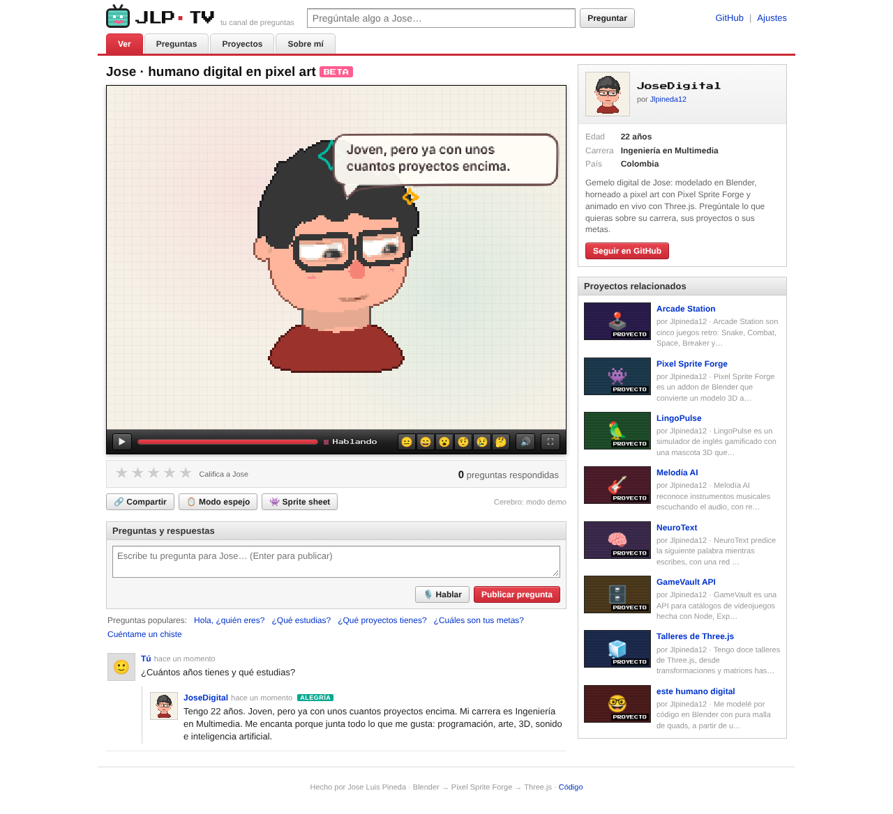
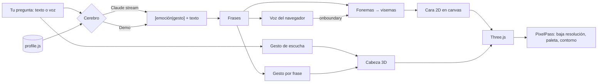

<div align="center">


# 👾 Jose · Humano Digital en pixel art <sup>BETA</sup>

**Mi gemelo digital en pixel art: conversa contigo en el navegador, responde sobre mi carrera, mis proyectos y mis metas, hace gestos según lo que le dices y mueve la boca con lip-sync en español.**


[](https://jlpineda12.github.io/digital-human/)

</div>

> 🧪 **Versión beta (0.9.0).** Soy Jose Luis Pineda: tengo 22 años y mi carrera es Ingeniería en Multimedia. Este es mi gemelo digital: un personaje modelado por código en Blender a partir de mi propio dibujo, convertido a pixel art con mi addon [Pixel Sprite Forge](https://github.com/Jlpineda12/pixel-sprite-forge) y animado en tiempo real con Three.js. La página imita un sitio de videos de los 2000: él es el video y tus preguntas son los comentarios. Es una beta: la voz depende de las voces en español de tu navegador y el reconocimiento de voz y el modo espejo necesitan Chrome o Edge. Se agradecen comentarios en *Issues*.

<div align="center">

</div>

## ✨ Qué hace

| | |
| :-- | :-- |
| 📺 **Interfaz de sitio de videos de los 2000** | Jose aparece en un reproductor con barra de controles (repetir, progreso de la respuesta, emociones, voz, pantalla completa), calificación con estrellas y "proyectos relacionados". Las preguntas se publican como comentarios y él responde en el hilo. |
| 👾 **Pixel art en vivo** | El modelo 3D se dibuja a baja resolución, sin suavizado, con mi paleta de 17 colores y un contorno de 1 px que toma un tono más oscuro del color vecino. Es el mismo proceso de [Pixel Sprite Forge](https://github.com/Jlpineda12/pixel-sprite-forge), pero en tiempo real (`src/fx/PixelPass.js`). |
| 🙋 **Sabe quién soy** | Responde sobre mi edad, mi carrera, mis proyectos, mis habilidades y mis aspiraciones. Si preguntas dos cosas a la vez ("¿cuántos años tienes y qué estudias?") responde las dos. Todo está en un solo archivo editable: [`src/ai/profile.js`](src/ai/profile.js). |
| 🤝 **Gestos según la conversación** | Asiente, niega, ladea la cabeza, piensa, se ríe, saluda, encoge los hombros, consuela… Reacciona a lo que escribes (una pregunta hace que ladee la cabeza, un saludo, que salude), a la etiqueta `[emoción\|gesto]` de cada respuesta y a cada frase mientras la dice. |
| 👄 **Lip-sync procedural** | El texto se convierte en fonemas del español, cada fonema en un **visema** y se mezclan con coarticulación; con la voz del navegador se resincroniza palabra por palabra. |
| 🎙️ **Voz y modo espejo** | Pregúntale hablando (reconocimiento de voz) o activa el modo espejo: imita tu boca a partir del micrófono (FFT), sin IA. |
| 😄 **Emociones** | Alegría, sorpresa, duda, tristeza, pensativo y neutral, con garabatos animados alrededor de la cabeza. |
| 🤖 **Dos cerebros** | Sin API key funciona en **modo demo** (sin internet) con respuestas sobre mi perfil. Con una key de Anthropic conversa libremente con **Claude** usando el mismo perfil. |

<div align="center">

</div>

## 👾 Versión pixel art hecha con Pixel Sprite Forge

Además del render en vivo, `blender/bake_pixel.py` construye el mismo modelo, le pone una animación idle (respira, mira a los lados y asiente) y la hornea con el addon en **8 direcciones**: 128×128 px, mi paleta [`assets/pixel/jose.hex`](assets/pixel/jose.hex), contorno adaptativo y *normal map*.

| Sprite sheet | Normal map | Por dirección |
| :-: | :-: | :-: |
|  |  |   |

Salida en [`docs/pixel/`](docs/pixel): `jose.png` + `jose.json` (Phaser, PixiJS, Unity), `jose_frames.tres` (Godot 4), `jose_n.png` y un GIF por dirección.

```bash
# con el addon clonado al lado: ../pixel-sprite-forge
python3 blender/bake_pixel.py            # o: --psf /ruta/a/pixel-sprite-forge
```

## 🧱 Del dibujo al 3D

El personaje se construye **100 % por script** en Blender a partir del dibujo de referencia, midiendo el dibujo en lugar de "a ojo":

1. `blender/extract_profiles.py` mide en la imagen la silueta del pelo, la línea del flequillo, el ancho de la cara y la forma de la nariz.
2. `blender/build_character.py` construye la malla con primitivas de **solo quads** y exporta `assets/models/jose.glb`. El cabello es un casco de quads con el flequillo en ondas (mechones redondeados que terminan en punta en las divisiones, como en el dibujo), volumen por mechones, patillas hasta la mitad de la oreja y una nuca con tres puntas.
3. Un render ortográfico a la misma escala del dibujo se compara píxel a píxel:

| Métrica | Resultado |
| :-- | :-- |
| Topología | **3.895 quads · 0 triángulos · 0 n-gons** (≈ 7.800 triángulos en GPU) |
| Coincidencia con el dibujo (IoU) | pelo **0,88** · nariz **0,83** · silueta **0,88** |

<div align="center">

</div>

```bash
python3 blender/extract_profiles.py
blender -b --factory-startup --python blender/build_character.py -- --render
```

## 🚀 Usarlo

Es una página estática, sin build:

```bash
python3 -m http.server 8080
```

Abre `http://localhost:8080`. Para conversar libremente con Claude: **Ajustes → Cerebro: Claude** y pega tu API key de Anthropic. La key solo vive en tu navegador (por defecto ni siquiera se guarda; puedes marcar "recordar").

Para cambiar lo que sabe de ti, edita [`src/ai/profile.js`](src/ai/profile.js): edad, carrera, habilidades, proyectos (con sus palabras clave) y aspiraciones. Los dos cerebros lo leen.

## ⚙️ Arquitectura



```
digital-human/
├── index.html · style.css         # la página estilo sitio de videos de los 2000
├── src/
│   ├── main.js                    # une todo: render, voz, comentarios, controles
│   ├── ai/profile.js              # ← lo que sabe de mí (editable)
│   ├── ai/brains.js               # Claude (SDK oficial) y modo demo
│   ├── behavior/gestures.js       # asentir, negar, ladear, reír, saludar…
│   ├── behavior/Behavior.js       # emociones, mirada, parpadeo, respiración
│   ├── fx/PixelPass.js            # post-proceso pixel art (paleta + contorno)
│   ├── fx/Doodles.js              # garabatos, globo de diálogo y subtítulos
│   ├── avatar/                    # GLB, materiales toon, cara 2D
│   ├── lipsync/                   # español → visemas, modo espejo
│   └── speech/Voice.js            # voz + reconocimiento de voz
├── blender/                       # modelo por script, medición, horneado pixel
├── assets/models/ · assets/pixel/ # jose.glb, paleta y avatar
├── docs/pixel/                    # sprite sheet, normal map, JSON, Godot, GIFs
└── tests/                         # unitarias (Node) + extremo a extremo (Playwright)
```

## 🧪 Pruebas

```bash
npm test                 # 55 pruebas: visemas, sentimiento, gestos, perfil, resorte de la mirada
node tests/e2e.cjs       # 20 pruebas en Chromium real (servidor en :8095)
```

La prueba de navegador comprueba que arranca en modo pixel, que **todos los píxeles del personaje son de la paleta**, que la boca se abre al hablar, que hace gestos al conversar, que responde edad y carrera en un mismo comentario, la barra de proyectos, las estrellas, la mirada, el parpadeo, las 6 emociones, la versión móvil y que no hay errores de JavaScript.

## 🗺️ Próximos pasos (hacia la 1.0)

- Voz neuronal con análisis del audio real para el lip-sync.
- Brazos en pixel art para gestos con las manos.
- Más expresiones (enojo, vergüenza, risa a carcajadas).
- Hornear también las emociones como animaciones del sprite sheet.

## 👤 Autor

**Jose Luis Pineda Barrera** · 22 años · Ingeniería en Multimedia · Colombia 🇨🇴 · [@Jlpineda12](https://github.com/Jlpineda12)
