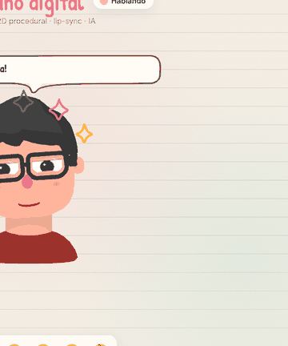
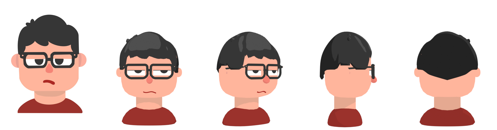
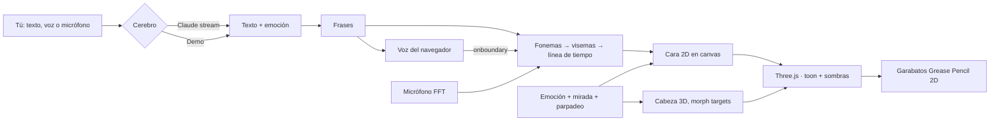

<div align="center">



# 🗣️ Jose · Humano Digital <sup>BETA</sup>

**Un personaje 3D estilizado que conversa contigo en el navegador: lip-sync procedural en español, mirada que te sigue, parpadeo natural y emociones en tiempo real.**


[](https://jlpineda12.github.io/digital-human/)

</div>

> 🧪 **Versión beta (0.9.0).** Gemelo digital de Jose Luis Pineda: un personaje 3D estilizado, modelado por código en Blender a partir de su propio dibujo y renderizado con Three.js, que conversa contigo en tiempo real en el navegador. Une **animación facial (morph targets + cara 2D procedural)**, **WebGL**, **IA multimodal** y **Web Speech**. Es una beta: la voz depende de las voces en español de tu navegador y algunas funciones (reconocimiento de voz, modo espejo) requieren Chrome o Edge. Se agradecen comentarios en *Issues*.

---

## ✨ Qué hace

| | |
| :-- | :-- |
| 🎨 **Mitad 3D, mitad 2D** | Cabeza, pelo, gafas y cuerpo son 3D (Blender → GLB), pero **ojos y boca se dibujan en 2D** cada frame sobre la cara, como en una animación tradicional. |
| 👄 **Lip-sync procedural** | El texto se convierte en fonemas del español (reglas para *h* muda, *qu*, *gu*, *ll*, *ch*, *ñ*, *ü*…), cada fonema en un **visema** (apertura, ancho, redondez, dientes, lengua) y se mezclan con coarticulación. Con la voz del navegador se **resincroniza palabra por palabra** (`onboundary`). |
| 🎙️ **Modo espejo** | Analiza tu micrófono en tiempo real (FFT): volumen → apertura, formantes graves/agudos → boca redonda/ancha, siseos → dientes. Imita tu boca sin IA. |
| 👀 **Mirada y gestos** | La cabeza y las pupilas siguen el cursor con resortes críticamente amortiguados, micro-sacadas, parpadeo aleatorio (a veces doble), respiración y cabeceos al hablar. |
| 😄 **Emociones** | Alegría, sorpresa, duda, tristeza, pensativo y neutral (su cara de aburrido del dibujo original). Las elige la IA en cada respuesta o el análisis de sentimiento del texto. Incluyen *morph targets* (mejillas que suben al sonreír, *squash* al hablar). |
| ✏️ **Toques Grease Pencil** | Garabatos dibujados a mano alrededor del personaje: chispas, "!" , "?", gota, globo de pensamiento y globo de diálogo, con trazos que "hierven" a 12 fps. |
| 🤖 **Cerebro con IA** | Con una API key de Anthropic conversa libremente usando **Claude** (`claude-opus-5-5`, streaming, empieza a hablar antes de terminar la respuesta). Sin key funciona en **modo demo** y habla de los proyectos de Jose. |

<div align="center">

</div>

## 🧱 Del dibujo al 3D

El personaje se construye **100 % por script** en Blender a partir del dibujo de referencia, midiendo el dibujo en lugar de "a ojo":

1. `blender/extract_profiles.py` mide en la imagen la silueta del pelo, la línea del flequillo, el ancho de la cara y la forma de la nariz.
2. `blender/build_character.py` construye la malla con primitivas de **solo quads** (cube-spheres superelípticas, casco de pelo con mechones, tubos curvos para las gafas), crea los *morph targets* y exporta `assets/models/jose.glb`.
3. Un render ortográfico a la misma escala del dibujo se compara píxel a píxel:

| Métrica | Resultado |
| :-- | :-- |
| Topología | **3.312 quads · 0 triángulos · 0 n-gons** (≈ 6.600 triángulos en GPU) |
| Coincidencia con el dibujo (IoU) | pelo **0,90** · nariz **0,83** · silueta **0,88** |
| Tamaño del modelo | 136 KB |

<div align="center">

</div>

```bash
python3 blender/extract_profiles.py
blender -b --factory-startup --python blender/build_character.py -- --render
```

## 🚀 Usarlo

Es una página estática, sin build:

```bash
python3 -m http.server 8080
```

Abre `http://localhost:8080`. Para conversar con Claude: ⚙️ **Ajustes → Cerebro: Claude** y pega tu API key de Anthropic. La key solo vive en tu navegador (por defecto ni siquiera se guarda; puedes marcar "recordar").

> La voz usa la síntesis del navegador: con voces en español (Chrome, Edge, Safari) suena mejor. Si no hay voz disponible, habla con subtítulos y el lip-sync sigue funcionando.

## ⚙️ Arquitectura



```
digital-human/
├── index.html · style.css
├── src/
│   ├── main.js                # une todo: render, voz, chat, ajustes
│   ├── avatar/Avatar.js       # GLB, materiales toon, sombras, pivote del cuello
│   ├── avatar/FaceCanvas.js   # ojos, párpados, pupilas, boca y rubor en 2D
│   ├── behavior/Behavior.js   # emociones, mirada, parpadeo, respiración
│   ├── lipsync/visemes.js     # español → fonemas → visemas → línea de tiempo
│   ├── lipsync/MicLipSync.js  # modo espejo con el micrófono
│   ├── speech/Voice.js        # voz + reconocimiento de voz
│   ├── emotion/sentiment.js   # sentimiento y etiquetas [emoción]
│   ├── ai/brains.js           # Claude (SDK oficial) y modo demo
│   └── fx/Doodles.js          # capa 2D estilo Grease Pencil
├── blender/                   # modelo por script, medición del dibujo, renders
├── assets/models/             # jose.glb + face.json (mapa UV de la cara)
├── vendor/                    # three.js y el SDK de Anthropic empaquetado
└── tests/                     # unitarias (Node) + extremo a extremo (Playwright)
```

## 🧪 Pruebas

```bash
npm test                 # 34 pruebas: visemas, fonemas, sentimiento, resorte de la mirada
node tests/e2e.cjs       # 14 pruebas en Chromium real (servidor en :8095)
```

La prueba de navegador comprueba que el modelo carga, que **la boca se abre y cambia de forma mientras habla**, que la cabeza sigue al cursor, que las pupilas quedan dentro del ojo, que parpadea solo, las 6 emociones, la versión móvil y que no hay errores de JavaScript.

## 🗺️ Próximos pasos (hacia la 1.0)

- Voz neuronal con análisis del audio real para el lip-sync (además de la línea de tiempo por fonemas).
- Animación de brazos/hombros y gestos según la emoción.
- Más expresiones y transiciones (enojo, vergüenza, risa).
- Modo kiosco / pantalla completa para presentaciones.

## 👤 Autor

**Jose Luis Pineda Barrera** · [@Jlpineda12](https://github.com/Jlpineda12) · Ingeniería en Multimedia, Colombia 🇨🇴
