<div align="center">

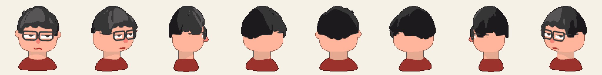

# 👾 Jose · Humano Digital en pixel art <sup>BETA</sup>

**Un chatbot con cara: mi gemelo digital en pixel art reacciona a cada pregunta, piensa, duda cuando no sabe, responde sobre mí con una voz procedural de 8 bits y mueve la boca al ritmo de cada sílaba.**


[](https://jlpineda12.github.io/digital-human/)

</div>

> 🧪 **Versión beta (0.9.0).** Soy Jose Luis Pineda: tengo 22 años y mi carrera es Ingeniería en Multimedia. Este es mi gemelo digital: un personaje modelado por código en Blender a partir de mi propio dibujo, convertido a pixel art con mi addon [Pixel Sprite Forge](https://github.com/Jlpineda12/pixel-sprite-forge) y animado en tiempo real con Three.js. Le escribes en el chat y él te responde con gestos, emociones y una voz de 8 bits. Es una beta: se agradecen comentarios en *Issues*.

<div align="center">
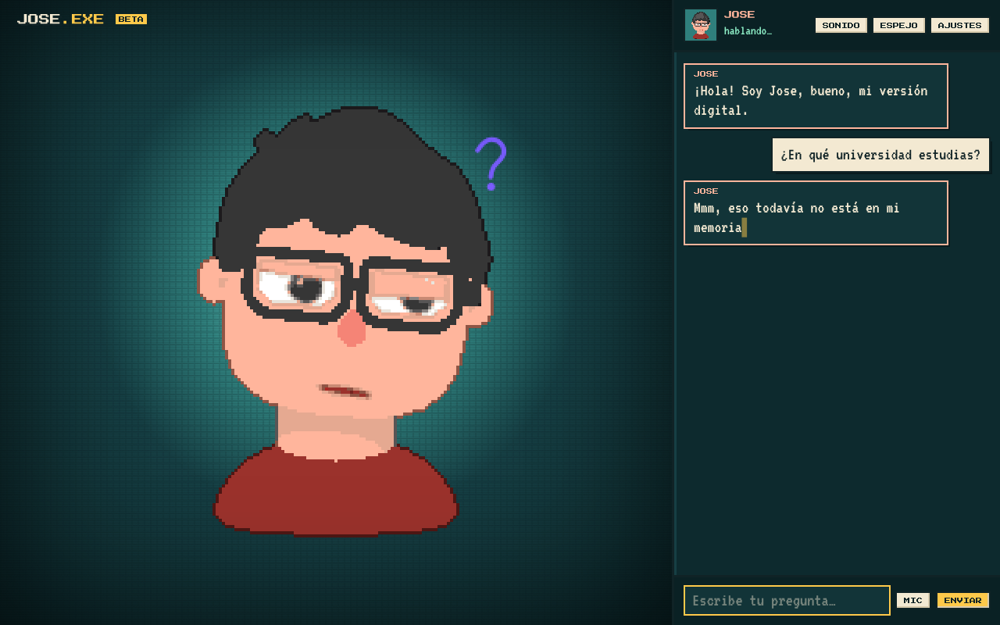
</div>

## ✨ Qué hace

| | |
| :-- | :-- |
| 🎭 **Gestos antes de cada respuesta** | Cada pregunta sigue una secuencia: **1)** reacciona (ladea la cabeza ante una pregunta, saluda si lo saludas, consuela si estás triste), **2)** **piensa**: levanta la mirada, inclina la cabeza y escribe "…" en el chat mientras el cerebro trabaja, **3)** si la pregunta es **dudosa** o no sabe la respuesta, pone cara de duda y encoge los hombros, **4)** responde con un gesto por frase (asiente, niega, se ríe, se enorgullece…). |
| 💬 **Chatbot** | Historial de conversación, varias preguntas seguidas (si preguntas mientras habla, tu pregunta espera su turno) y varias preguntas en un mismo mensaje: "¿cuántos años tienes, qué estudias y cuáles son tus metas?" tiene las tres respuestas. |
| 🔊 **Voz procedural de 8 bits** | Nada de voz robótica: cada sílaba es un "blip" sintetizado con Web Audio. El tono depende de la vocal (i/e agudas, o/u graves), de la emoción (alegre = más agudo, triste = más grave) y de la frase (las preguntas suben al final). La burbuja del chat se escribe letra por letra al mismo ritmo. La voz del navegador sigue disponible en Ajustes. |
| 🙋 **Sabe quién soy** | Edad, carrera, proyectos, habilidades y aspiraciones, desde un solo archivo editable: [`src/ai/profile.js`](src/ai/profile.js). No inventa: lo que no sabe lo dice con duda. |
| 👾 **Pixel art en vivo** | El modelo 3D se dibuja a baja resolución con mi paleta de 17 colores y un contorno de 1 px (`src/fx/PixelPass.js`), el mismo proceso de Pixel Sprite Forge pero en tiempo real. |
| 🎨 **Teoría del color** | Jose es cálido (piel durazno, camisa roja), así que todo lo demás vive en su complementario: un verde azulado oscuro. Un foco claro sigue su cabeza (su pelo casi negro necesita un fondo claro) y el borde cae en viñeta: gana por tono, temperatura y valor. El mostaza (acento triádico) se reserva para detalles pequeños. |
| 👄 **Lip-sync y mirada** | Español → fonemas → visemas con coarticulación; la cabeza y las pupilas siguen el cursor, parpadea solo y respira. Modo espejo: imita tu boca con el micrófono. |
| 🤖 **Dos cerebros** | Sin API key funciona en **modo demo** (sin internet). Con una key de Anthropic conversa libremente con **Claude**, que elige la emoción y el gesto de cada respuesta con una etiqueta `[emoción\|gesto]`. |

<div align="center">
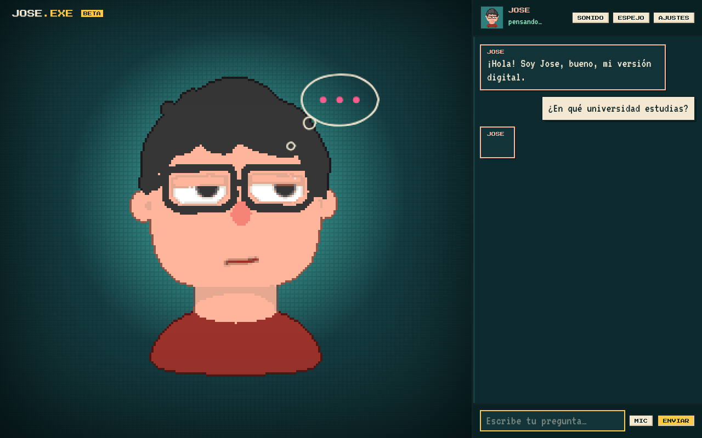 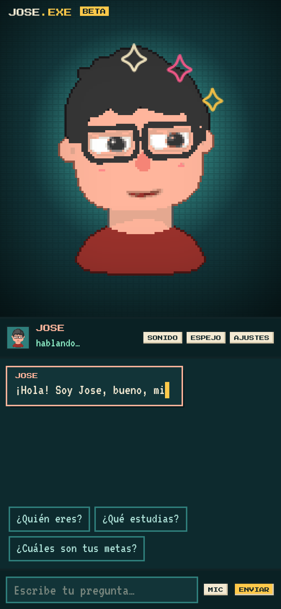
</div>

<div align="center">
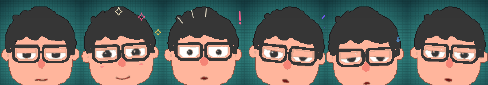
</div>

## 👾 Versión pixel art hecha con Pixel Sprite Forge

Además del render en vivo, `blender/bake_pixel.py` construye el mismo modelo, le pone una animación idle (respira, mira a los lados y asiente) y la hornea con el addon en **8 direcciones**: 128×128 px, mi paleta [`assets/pixel/jose.hex`](assets/pixel/jose.hex), contorno adaptativo y *normal map*.

| Sprite sheet | Normal map | Por dirección |
| :-: | :-: | :-: |
| 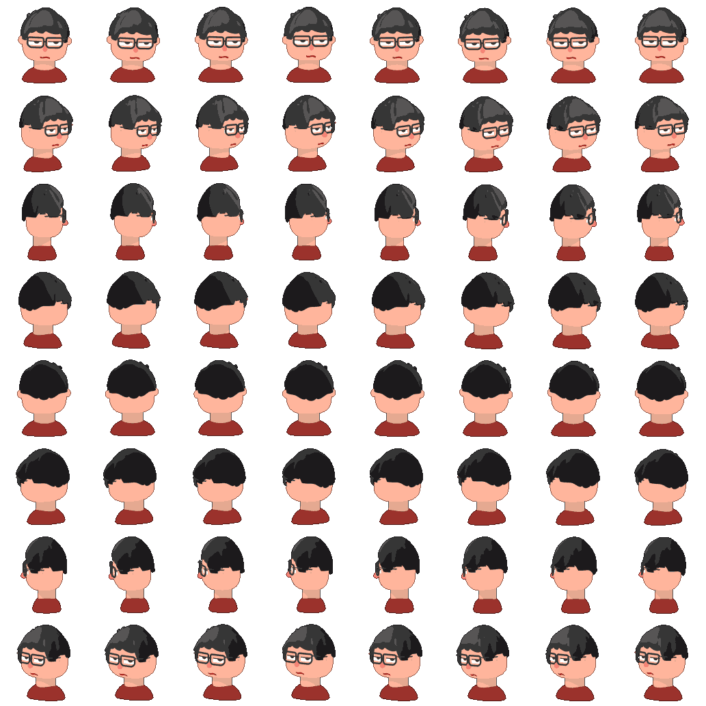 | 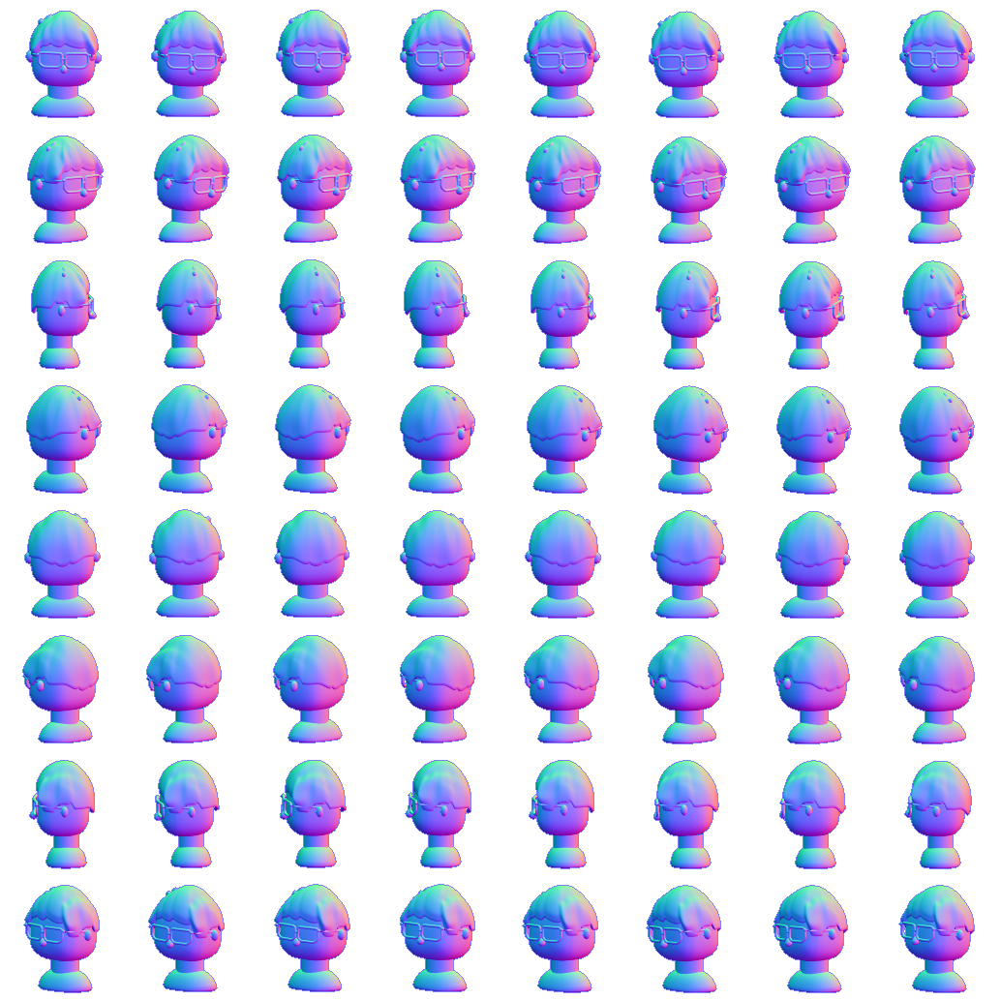 | 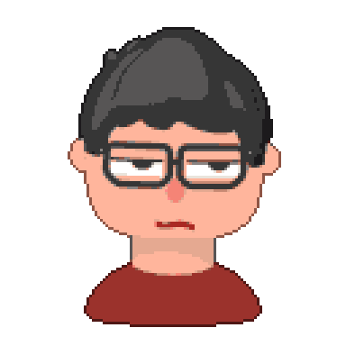 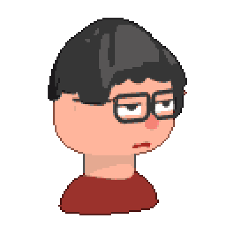 |

Salida en [`docs/pixel/`](docs/pixel): `jose.png` + `jose.json` (Phaser, PixiJS, Unity), `jose_frames.tres` (Godot 4), `jose_n.png` y un GIF por dirección.

```bash
# con el addon clonado al lado: ../pixel-sprite-forge
python3 blender/bake_pixel.py            # o: --psf /ruta/a/pixel-sprite-forge
```

## 🧱 Del dibujo al 3D

El personaje se construye **100 % por script** en Blender a partir del dibujo de referencia, midiendo el dibujo en lugar de "a ojo":

1. `blender/extract_profiles.py` mide en la imagen la silueta del pelo, la línea del flequillo, el ancho de la cara y la forma de la nariz.
2. `blender/build_character.py` construye la malla con primitivas de **solo quads** y exporta `assets/models/jose.glb`. El cabello es un casco de quads con el flequillo en ondas (mechones redondeados que terminan en punta en las divisiones, como en el dibujo), volumen por mechones, patillas hasta la mitad de la oreja y una nuca con tres puntas.
3. Un render ortográfico a la misma escala del dibujo se compara píxel a píxel:

| Métrica | Resultado |
| :-- | :-- |
| Topología | **3.895 quads · 0 triángulos · 0 n-gons** (≈ 7.800 triángulos en GPU) |
| Coincidencia con el dibujo (IoU) | pelo **0,88** · nariz **0,83** · silueta **0,88** |

<div align="center">
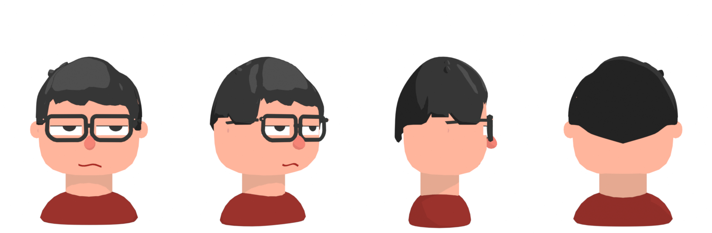
</div>

```bash
python3 blender/extract_profiles.py
blender -b --factory-startup --python blender/build_character.py -- --render
```

## 🚀 Usarlo

Es una página estática, sin build:

```bash
python3 -m http.server 8080
```

Abre `http://localhost:8080` y escríbele. El sonido se activa con tu primer clic o tecla (regla de los navegadores). Para conversar libremente con Claude: **Ajustes → Cerebro: Claude** y pega tu API key de Anthropic. La key solo vive en tu navegador (por defecto ni siquiera se guarda; puedes marcar "recordar").

Para cambiar lo que sabe de ti, edita [`src/ai/profile.js`](src/ai/profile.js): edad, carrera, habilidades, proyectos (con sus palabras clave) y aspiraciones. Los dos cerebros lo leen.

## ⚙️ Arquitectura

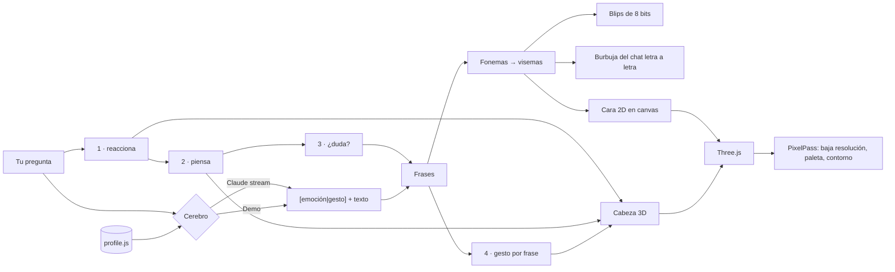

```
digital-human/
├── index.html · style.css         # escenario + chat, teoría del color
├── src/
│   ├── main.js                    # une todo: render, chat, secuencia de gestos
│   ├── ai/profile.js              # ← lo que sabe de mí (editable)
│   ├── ai/brains.js               # Claude (SDK oficial) y modo demo
│   ├── behavior/gestures.js       # asentir, negar, ladear, pensando, dudar, reír…
│   ├── behavior/Behavior.js       # emociones, mirada, parpadeo, respiración
│   ├── fx/PixelPass.js            # post-proceso pixel art (paleta + contorno)
│   ├── fx/Doodles.js              # garabatos alrededor de la cabeza
│   ├── avatar/                    # GLB, materiales toon, cara 2D
│   ├── lipsync/                   # español → visemas, modo espejo
│   ├── speech/Blips.js            # voz procedural de 8 bits (Web Audio)
│   └── speech/Voice.js            # voz, máquina de escribir, reconocimiento de voz
├── blender/                       # modelo por script, medición, horneado pixel
├── assets/models/ · assets/pixel/ # jose.glb, paleta y avatar
├── docs/pixel/                    # sprite sheet, normal map, JSON, Godot, GIFs
└── tests/                         # unitarias (Node) + extremo a extremo (Playwright)
```

## 🧪 Pruebas

```bash
npm test                 # 64 pruebas: visemas, blips, gestos, perfil, sentimiento, mirada
node tests/e2e.cjs       # 24 pruebas en Chromium real (servidor en :8095)
```

La prueba de navegador comprueba que arranca en pixel art con **todos los píxeles de la paleta**, la **secuencia de gestos** (reacciona → piensa → responde, y duda antes de una pregunta dudosa), que la burbuja se escribe al ritmo de la voz, que los blips suenan, que responde varias preguntas en un mensaje, el historial del chat, que no hay emojis ni textos de proyectos en pantalla, la boca, la mirada, el parpadeo, las 6 emociones, la versión móvil y que no hay errores de JavaScript.

## 🗺️ Próximos pasos (hacia la 1.0)

- Más timbres de blips (uno por personaje) y efectos de sonido para los gestos.
- Brazos en pixel art para gestos con las manos.
- Más expresiones (enojo, vergüenza, risa a carcajadas).
- Hornear también las emociones como animaciones del sprite sheet.

## 👤 Autor

**Jose Luis Pineda Barrera** · 22 años · Ingeniería en Multimedia · Colombia 🇨🇴 · [@Jlpineda12](https://github.com/Jlpineda12)
